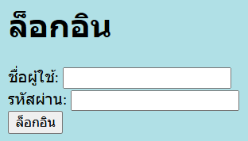
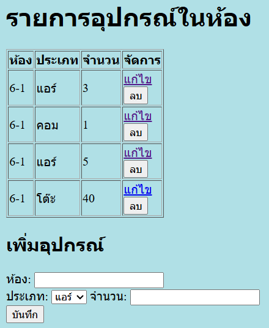
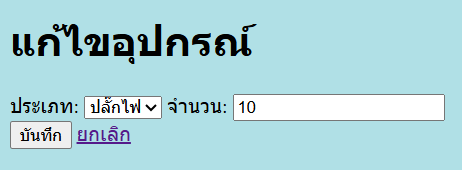

# Equipment Inventory

A small web application for keeping track of equipment in rooms (air conditioners, computers, TVs, desks, and so on). Built as a self-study project to practice full stack basics: an HTML front end, a PHP back end, and a MySQL database.

Login Page

Main Page

Edit Page


## Features

- View all equipment in a table, with its room, type, and quantity
- Add equipment to an existing room
- Edit the type and quantity of an item
- Delete an item (with a confirmation prompt)
- Add new rooms (duplicate and empty names are rejected)
- Input validation on the server (quantity must not be negative, room name required)

## Tech Stack

| Layer | Technology |
|---|---|
| Front end | HTML, CSS |
| Back end | PHP (mysqli) |
| Database | MySQL / MariaDB |
| Local server | XAMPP (Apache + MySQL) |

## Database Design

Two related tables:

- `rooms` (`id`, `name`, `floor`)
- `equipment` (`id`, `room_id`, `type`, `quantity`), where `room_id` is a foreign key to `rooms.id`

The full structure and sample data are in `schema.sql`.

## Security Practices

- **Prepared statements** for every query that uses user input, to prevent SQL injection
- **`htmlspecialchars`** when printing database values into the page, to prevent XSS
- **Server-side validation**, so rules still apply if the browser checks are bypassed
- **Redirect after POST**, so refreshing the page does not resubmit a form

## How to Run Locally

1. Install [XAMPP](https://www.apachefriends.org/) and start **Apache** and **MySQL** in the XAMPP Control Panel.
2. Copy this folder into `C:\xampp\htdocs\` (for example `C:\xampp\htdocs\equipment-app`).
3. Open `http://localhost/phpmyadmin`, go to the **Import** tab, and import `schema.sql`. This creates the `equipment_db` database and its tables.
4. Open `db.php` and check the connection settings. The port is set to `3307`; change it to `3306` if your MySQL uses the default port.
5. Open `http://localhost/equipment-app/hello.php` in your browser.

> `db.php` uses the `root` user with an empty password. This is the XAMPP default and is for local testing only. Never use these settings on a real server.

## Project Structure

```
equipment-app/
├── hello.php     # main page: list, add equipment, add room, delete
├── edit.php      # edit page for one item
├── db.php        # database connection and the list of equipment types
├── schema.sql    # database structure and sample data
└── README.md
```

## What I Learned

- How a browser, a PHP server, and a database work together in a CRUD application
- Writing SQL queries with joins and connecting them to PHP safely
- Basic web security: SQL injection, XSS, and server-side validation
- Debugging form handling (GET vs POST, duplicate submissions, hidden fields)

## Ideas for Improvement

- Replace the room text field with a dropdown loaded from the database
- Show rooms that have no equipment yet (using a `LEFT JOIN`)
- Add a unique constraint on room names at the database level
- Add user login
