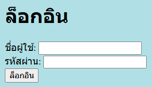
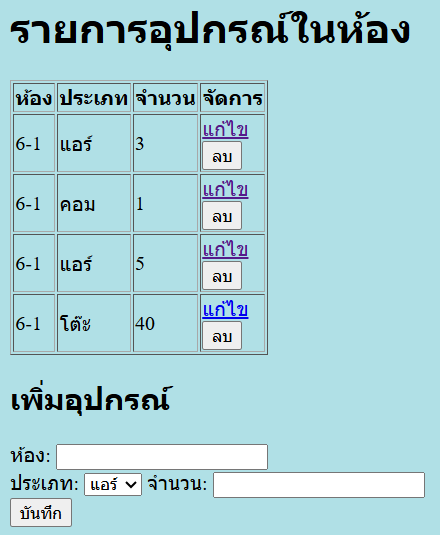
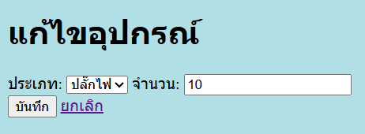

# Equipment Inventory

A small web application for keeping track of equipment in rooms (air conditioners, computers, TVs, power outlets, and so on), with user login, role-based permissions, and a room management page. Built as a self-study project to practice full stack basics: an HTML front end, a PHP back end, and a MySQL database.

## Screenshots

| Login | Equipment list (Admin) | Room list (Admin) |
|---|---|---|
|  |  |  |

| Edit equipment | Equipment list (Guest) |
|---|---|
|  |  |

## Features

- Login and logout with session handling
- Three roles with different permissions (see below)
- Equipment: view, add, edit, and delete, with each item linked to a room
- Rooms: view, add, edit, and delete on a separate page
- A room can only be deleted when it has no equipment
- Server-side input validation (required room name, no duplicate room names, quantity must not be negative)
- Controls that a role cannot use are hidden in the interface

## Roles and Permissions

| Role | View equipment and rooms | Add / edit equipment | Delete equipment | Add / edit / delete rooms |
|---|:---:|:---:|:---:|:---:|
| Guest | yes | no | no | no |
| Staff | yes | yes | no | no |
| Admin | yes | yes | yes | yes |

Permissions are checked on the server for every action, not only in the interface.

## Tech Stack

| Layer | Technology |
|---|---|
| Front end | HTML forms, basic CSS |
| Back end | PHP (mysqli, sessions) |
| Database | MySQL / MariaDB |
| Local server | XAMPP (Apache + MySQL) |

## Database Design

Three tables:

- `rooms` (`id`, `name`, `floor`)
- `equipment` (`id`, `room_id`, `type`, `quantity`), where `room_id` is a foreign key to `rooms.id`
- `users` (`username`, `password` as a bcrypt hash, `role`)

The full structure and demo data are in `schema.sql`.

## Security Practices

- **Prepared statements** for every query that uses user input, to prevent SQL injection
- **`htmlspecialchars`** when printing database values into the page, to prevent XSS
- **Password hashing** with `password_hash` and `password_verify` (bcrypt), so plain-text passwords are never stored
- **Session handling:** `session_regenerate_id` after login, and every page redirects to the login page when no session exists
- **Role checks on the server**, so permissions cannot be bypassed by sending requests directly
- **Server-side validation**, so rules still apply if the browser checks are bypassed
- **Redirect after POST**, so refreshing the page does not resubmit a form

## How to Run Locally

1. Install [XAMPP](https://www.apachefriends.org/) and start **Apache** and **MySQL** in the XAMPP Control Panel.
2. Copy this folder into `C:\xampp\htdocs\` (for example `C:\xampp\htdocs\equipment-app`).
3. Open `http://localhost/phpmyadmin` and create an empty database named `equipment_db` (collation `utf8mb4_unicode_ci`).
4. Select `equipment_db`, go to the **Import** tab, choose `schema.sql`, and run it. This creates the tables and demo data.
5. Open `db.php` and check the connection settings. The port is set to `3307`; change it to `3306` if your MySQL uses the default port.
6. Open `http://localhost/equipment-app/login.php` in your browser and sign in with a demo account.

### Demo Accounts

| Username | Password | Role |
|---|---|---|
| `admin_demo` | `AdminDemo#1` | Admin |
| `staff_demo` | `StaffDemo#1` | Staff |
| `guest_demo` | `GuestDemo#1` | Guest |

> These accounts and passwords are for local testing only. `db.php` also uses the XAMPP default `root` user with an empty password. Never use these settings on a real server.

## Project Structure

```
equipment-app/
├── login.php       # login page
├── logout.php      # ends the session
├── hello.php       # equipment list, add and delete equipment
├── edit.php        # edit one equipment item
├── room.php        # room list, add and delete rooms
├── edit_room.php   # edit one room
├── db.php          # database connection and the list of equipment types
├── schema.sql      # database structure and demo data
├── screenshots/    # images used in this README
└── README.md
```

## Known Limitations

- No CSRF protection on forms
- No limit on repeated failed login attempts
- No page for managing users (accounts are added through SQL)
- The floor choices (6 and 7) and the equipment types are fixed in the code
- Meant for local learning, not production use

## What I Learned

- How a browser, a PHP server, and a database work together in a CRUD application
- Writing SQL queries with joins and connecting them to PHP safely
- Basic web security: SQL injection, XSS, password hashing, sessions, and checking permissions on the server
- Working with foreign keys, such as preventing deletion of a room that still has equipment
- Debugging form handling (GET vs POST, duplicate submissions, hidden fields, redirect loops)

## Ideas for Improvement

- Replace the room text field in the equipment form with a dropdown loaded from the database
- Show the number of equipment items per room on the room page (`GROUP BY`)
- Add CSRF tokens and a login attempt limit
- Add a page for managing users and changing passwords
- Add search and filtering on the equipment list
